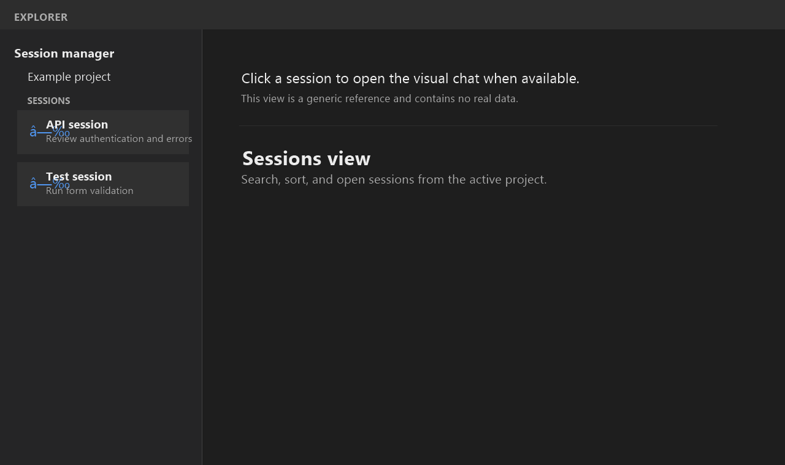
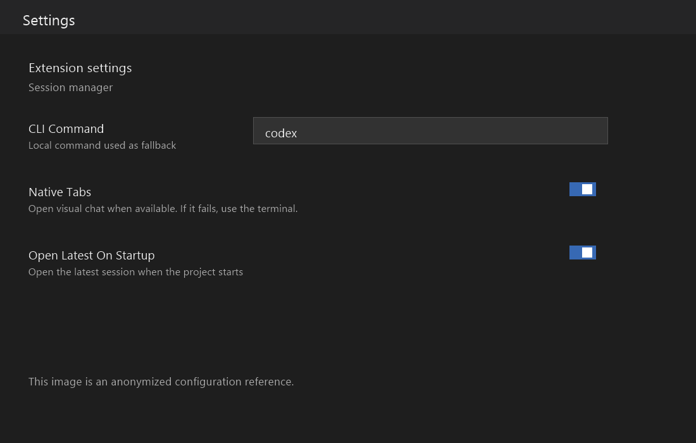

# Codex Workspace Manager

Codex Workspace Manager is an independent VS Code companion for finding local Codex sessions related to the current workspace.

## What it provides

- Workspace-aware session discovery.
- Search, sorting, previews, and pinned sessions.
- A read-only view of the local session record.
- Visual chat opening when the official Codex extension is available.
- A safe terminal fallback when visual opening is unavailable.
- Optional opening of the latest session when VS Code starts.

## Requirements

- VS Code 1.90 or later.
- The official OpenAI Codex extension is recommended for visual chat opening. VS Code can install declared extension dependencies automatically.
- The Codex CLI is needed only for the terminal fallback.

## Screenshots

The screenshots are anonymized and contain no real session names, IDs, local paths, private messages, or project names.

## Repository scope

This public repository contains product documentation, release notes, and anonymized screenshots. The extension source code is maintained separately.

## Privacy

The extension reads local session metadata to filter sessions by the active workspace. It does not upload session content or modify Codex session files.

## Release notes

See [CHANGELOG.md](CHANGELOG.md) for the release history.
